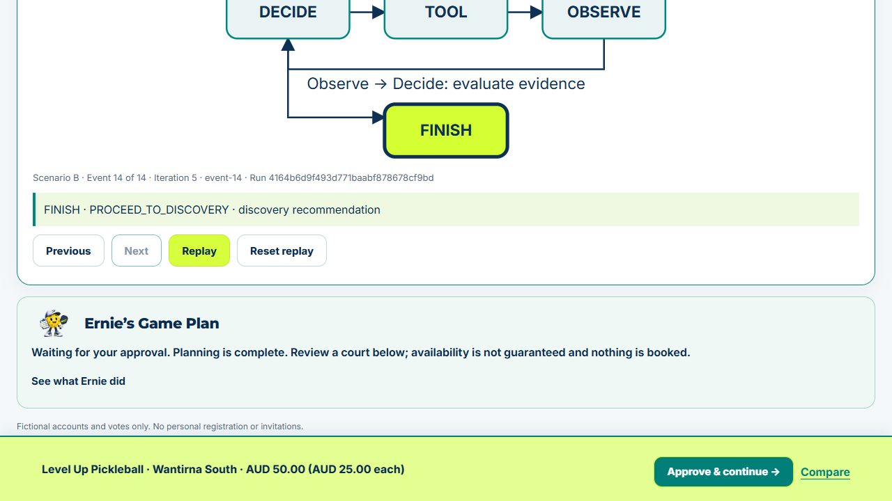

# Game On! - Week 3 submission

**Less group-chat chaos. More time on court.** Game On helps a Melbourne pickleball
group agree on a time, compare courts and reach a human-controlled booking handoff.

This repository contains the **actual Game On product code**, including FastAPI,
Neon Auth integration, persistent groups, voting, MapLibre, Ernie's LangGraph and
the local Playbypoint adapter. It is a clean submission snapshot with fresh history;
internal journals, prompts, handoffs, telemetry, account data and credentials are excluded.

## Start here

| Link | What to expect |
|---|---|
| [Live application](https://game-on-victoria.vercel.app) | Real account login and private groups; hosted deterministic planning and booking handoff |
| [Agent Brain demonstration](https://game-on-w3-demo.vercel.app) | No login; actual LangGraph with clearly simulated inventory/prices; scenarios A/B/C |
| [Architecture](submission/architecture.svg) | Product, isolated demonstration and local browser boundaries |
| [User flow](submission/user-flow.svg) | Coordination, planning, organiser approval and external booking handoff |
| [Three-minute video](submission/demo-video.mp4) | Narrated, edited recordings of actual hosted demo runs plus labelled historical evidence; download to play if GitHub shows a file preview |
| [Storyboard](submission/demo-storyboard.md) | Exact screens, clicks, narration and evidence references |
| [Three-page overview](submission/project-overview.pdf) | Problem, implementation, architecture and limitations |
| [Six-slide outline](submission/presentation-outline.md) | Presentation structure and visual references |
| [Acceptance checklist](submission/verification.md) | Fresh, historical, simulated and unverified results |

The Agent Brain demo is a **separate existing deployment**, not the application in
this repository. Neither link is deployed automatically from this submission snapshot.



## What Ernie actually does

The bounded graph executes **decide -> tool -> observe -> decide**, validating each
action against the group snapshot, eligible times and allowed tools. Python enforces
deadlines, tool limits, organiser access and stale-plan checks. The current decision
policy is deterministic: **no live LLM inference is claimed**. An existing guarded
model adapter is included in source but paid calls are not enabled for submission.

- **Hosted product:** reads group votes, calculates qualifying times, searches the
  curated venue directory, ranks geography/preferences, and presents a proposal.
  Cached prices require an exact match; absent prices remain unknown.
- **Agent Brain demo:** A finds an option; B observes an empty result and executes
  a second search at another already-approved time; C exhausts permitted options
  and requests human help. Tool execution is real; provider observations are fixtures.
  The visualisation replays completed events, not streamed model reasoning.
- **Local Playwright:** the I-069 adapter navigated Pickleholic and returned seven
  offered courts for 7 November 2026, 18:30-19:30 Melbourne. Separately approved
  navigation reached Court 3's summary: $50 + $1.25 fee = $51.25, one provider player,
  observed 6 November at 01:37:41 UTC. Currency code and separate tax were not shown.
  The existing graph consumed the real observation. This is historical evidence,
  not current availability or a universal rate. See [evidence](submission/verification.md).

## Run the product locally

Use Python 3.13. No credentials are needed for the existing local SQLite mode.

```sh
python -m venv .venv
# Activate .venv using your operating system's command.
python -m pip install -r requirements-dev.txt
python app.py
# Open http://localhost:8000
python -m unittest discover -s tests -v
```

Start in a clean shell with no DATABASE_URL, NEON_AUTH_URL, VERCEL or production
environment variables. SQLite data is created locally and ignored by Git. Local
membership-token mode is not evidence of Neon login; actual hosted accounts use
Neon Managed Better Auth with server-side JWT verification.

Browser tests additionally require `python -m playwright install chromium` and
`PLAYWRIGHT_CHROMIUM_EXECUTABLE` pointing to that installation (the original Windows
test default is retained). Optional PostgreSQL tests skip unless TEST_DATABASE_URL
is explicitly configured. Do not point tests at a shared database.

Hosted deployment is deliberately **not turnkey**: deployment target identifiers
were replaced with non-working submission placeholders, while fail-closed guards
remain. No database, auth endpoint, Vercel project link or secret is supplied.
Independent hosting requires your own reviewed configuration; do not reuse the
author's environment. This checkpoint does not create infrastructure or deploy.

## Code guide

| Path | Responsibility |
|---|---|
| `app.py`, `web/` | FastAPI routes and responsive vanilla HTML/CSS/JavaScript |
| `gameon/auth.py`, `accounts.py`, `groups.py` | Verified identity, persistent membership and permissions |
| `gameon/erne/graph.py`, `policy.py`, `tools.py` | Real LangGraph execution and validated actions |
| `gameon/erne/playbypoint*.py` | Shared local browser adapter, observations and approval boundaries |
| `gameon/venues/`, `pricing.py`, `booking.py` | Curated ranking, exact-context prices and safe handoff |
| `tests/` | Scheduling, security, graph, storage, pricing and browser regression tests |

Only publication-specific changes were made: remove private deployment identifiers,
move necessary recorded fixtures out of internal docs, and add submission materials.
Core product behaviour was not redesigned. Third-party font, MapLibre and Neon SDK
licence notices remain with the assets.

Source provenance: product snapshot `27447eb2f14cf26da770c7c98cfea62416f6c536`
(I-069 implementation `769c92aa07d6e8637ac28ca68f3f393bba077963`).
The live product remains release `b85c583ffd6fcbe82be130cc3936d7ab3a4450b0`
through I-065; the local provider extension in this source has not been deployed.

## Boundaries

Nothing here confirms a reservation or payment. Approval means approval to enquire.
The official booking link may require court/time reselection. A calendar download
is tentative and a copied assistant brief requires user confirmation before booking.

Live selection is local-only and opt-in, currently limited to verified one-hour,
half-hour-aligned slots within 14 days. Next can potentially create a hold and always
requires separate specific approval. No provider calls are needed to mark this
submission. Level Up's full live graph acceptance remains blocked by a security
challenge. Hosted browser execution, autonomous checkout and real unavailable-slot
replanning are not verified. The demo demonstrates the latter with labelled fixtures.

Maps show approximate player suburbs, not home addresses. Venue coverage is curated,
not exhaustive. Public repository access does not grant access to private groups.
